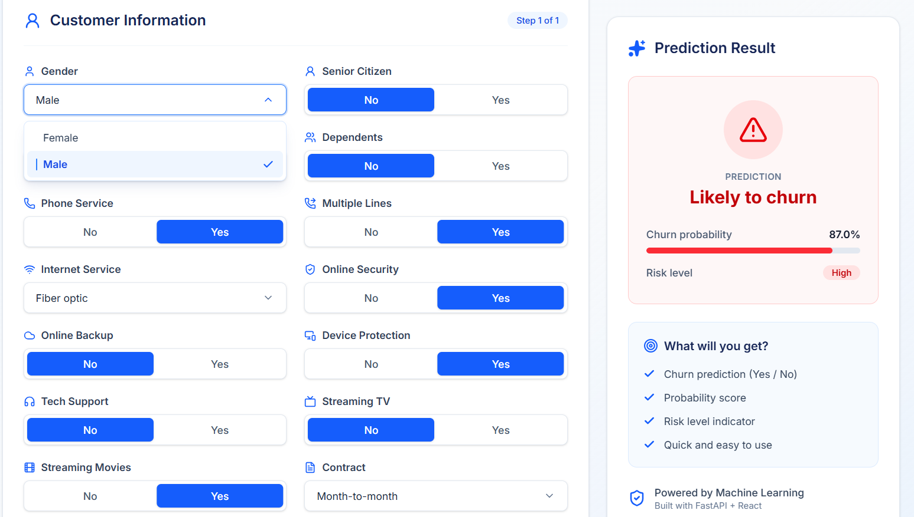

# Customer Churn Prediction

A full-stack machine learning application that predicts whether a telecom customer is likely to **churn (leave the service) or stay**. Users can enter customer details through an interactive web interface and receive a churn prediction, estimated churn probability, and risk level.

The project combines a machine learning pipeline with a REST API and a React frontend to demonstrate how a trained ML model can be integrated into a working application.



## Project Overview

This project demonstrates the development of an end-to-end machine learning application, from model training and preprocessing to API development and frontend integration.

- **Machine Learning:** A stacking ensemble combining XGBoost, Random Forest, CatBoost, and LightGBM, with Logistic Regression as the final estimator.
- **Backend:** FastAPI REST API that validates incoming data, processes customer details, and serves predictions using the trained model.
- **Frontend:** React and Tailwind CSS, built with Vite, providing a responsive interface for entering customer information and viewing predictions.
- **Model Persistence:** Joblib is used to save and load the trained model and preprocessing objects.

## Machine Learning

### Problem Statement

Customer churn occurs when a customer stops using a company's services. Predicting potential churn can help telecom companies identify customers who may leave and take appropriate retention measures.

This project treats churn prediction as a **binary classification problem**:

- `1` — Customer is likely to churn.
- `0` — Customer is likely to stay.

### Dataset

The model uses telecom customer data containing information about customer demographics, account details, subscribed services, contract types, payment methods, tenure, and monthly charges.

The target variable indicates whether a customer churned.

Dataset Link : https://www.kaggle.com/datasets/blastchar/telco-customer-churn

### Data Preprocessing

The preprocessing pipeline prepares customer data for the machine learning models.

- **Encoding:** Converts categorical features into numerical representations using a saved encoder.
- **Feature scaling:** Uses a saved scaler to normalize numerical features where required.
- **Redundant category handling**: Consolidated "No internet service" and "No phone service" categories into "No" across the six relevant service columns, as these categories were determined by InternetService or PhoneService and did not provide additional independent information.
- **Class Imbalance Handling**: Applied SMOTE (Synthetic Minority Over-sampling Technique) to generate synthetic churn samples and balance the training dataset, as the original dataset contained significantly fewer churners than non-churners. This helps the model learn patterns associated with the minority churn class.

### Model Architecture

The application uses a **stacking ensemble** consisting of four base models:

- XGBoost
- Random Forest
- CatBoost
- LightGBM

Their predictions are combined by a Logistic Regression meta-model, which learns how to produce the final classification from the base models' outputs.

This approach combines multiple tree-based learning algorithms with a separate model that learns how to combine their predictions.

### Model Evaluation

Model performance should be evaluated using metrics appropriate for an imbalanced classification problem.

- **Recall:** Measures the proportion of actual churners correctly identified.
- **Precision:** Measures the proportion of predicted churners who actually churned.
- **F1-score:** Balances precision and recall.
- **ROC-AUC:** Measures how effectively the model distinguishes between churners and non-churners across classification thresholds.

**Recall is prioritized over precision** because failing to identify a customer who is about to churn (false negative) means missing an opportunity for customer retention. In contrast, a false positive results in an unnecessary retention offer, which is generally a less costly mistake. Therefore, the model prioritizes identifying as many potential churners as possible, while accepting a lower precision as a trade-off.

| Metric | Validation Set | Test Set |
|---|---:|---:|
| Accuracy | 78% | 79% |
| Churn Precision | 56% | 58% |
| Churn Recall | 76% | 78% |
| Churn F1-score | 64% | 67% |
| ROC-AUC | 0.8531 | 0.8620 |

## Application Architecture

The application follows this prediction workflow:

1. **User input:** The customer enters their details through the React frontend.
2. **Frontend validation:** The application checks the input before sending the request.
3. **API request:** The frontend sends the customer data as JSON to the FastAPI `/predict` endpoint.
4. **Preprocessing:** The backend applies the saved encoder and scaler.
5. **Model inference:** The trained stacking ensemble generates a prediction and churn probability.
6. **API response:** FastAPI returns the prediction result and related information as JSON.
7. **Result display:** The frontend presents the prediction, probability, and risk level to the user.

React communicates with the ML model through the REST API rather than accessing the model files directly.

## Technologies Used

| Category | Technologies |
|---|---|
| Programming language | Python, JavaScript |
| Machine learning | Scikit-learn, XGBoost, Random Forest, CatBoost, LightGBM |
| Data processing | Pandas, NumPy |
| Model persistence | Joblib |
| Backend / API | FastAPI, Uvicorn |
| Frontend | React, Tailwind CSS |
| Build tool | Vite |
| API communication | HTTP, JSON |

## Project Structure

```text
churn project/
├── api.py
├── predict.py
├── train.py
├── encoder.joblib
├── scaler.joblib
├── stack_model.joblib
├── requirements.txt
├── requirements-train.txt
├── images/
│   └── img1.png
└── frontend/
    ├── package.json
    ├── vite.config.js
    └── src/
        ├── App.jsx
        ├── api.js
        ├── fields.js
        ├── validation.js
        └── components/
```

## Requirements

- Python 3.13
- Node.js 20.19+ or 22.12+, as supported by the project configuration
- npm

Check the installed versions:

```bash
python --version
node --version
npm --version
```

## Installation

Open a terminal in the project root directory.

### 1. Install Python dependencies

```bash
pip install -r requirements.txt
```

The requirements file contains the pinned package versions used by the application. Using compatible versions is important because serialized models can depend on the libraries and versions used during training.

### 2. Install frontend dependencies

```bash
cd frontend
npm install
```

## Running the Application

The backend and frontend must run simultaneously in separate terminals.

### Terminal 1: Start the API

From the project root:

```bash
python -m uvicorn api:app --reload
```

The API will be available at:

`http://127.0.0.1:8000`

Interactive API documentation:

`http://127.0.0.1:8000/docs`

### Terminal 2: Start the frontend

```bash
cd frontend
npm run dev
```

Open the local URL displayed by Vite, usually:

`http://localhost:5173`

Enter the customer's details and select **Predict Churn** to view the result.

Keep both terminals running while using the application.

## Using the API Directly

The API exposes a prediction endpoint:

`POST /predict`

Example request:

```json
{
  "gender": "Male",
  "SeniorCitizen": 1,
  "Partner": "Yes",
  "Dependents": "No",
  "tenure": 12,
  "PhoneService": "Yes",
  "MultipleLines": "No",
  "InternetService": "DSL",
  "OnlineSecurity": "No",
  "OnlineBackup": "No",
  "DeviceProtection": "Yes",
  "TechSupport": "Yes",
  "StreamingTV": "No",
  "StreamingMovies": "No",
  "Contract": "Month-to-month",
  "PaperlessBilling": "No",
  "PaymentMethod": "Electronic check",
  "MonthlyCharges": 70.35
}
```

Example successful response:

```json
{
  "prediction": 1,
  "probability": 0.78,
  "success": true,
  "message": "Successfully calculated the Churn"
}
```

The example values illustrate the response format; they are not a benchmark result.

- `prediction`: `1` indicates churn; `0` indicates stay.
- `probability`: Estimated probability of churn, assuming the API's implementation returns the churn-class probability.
- `success`: Indicates whether the prediction request succeeded.
- `message`: Describes the result.

Invalid or missing data produce an error response according to the API's validation logic.

### Input Validation

- All 18 fields are required.
- Categorical values must match the accepted options.
- `SeniorCitizen` must be `0` or `1`.
- `tenure` must be a non-negative whole number.
- `MonthlyCharges` must be a non-negative number.

## Retraining the Model

Retraining is optional. It requires the training dataset, `data.csv`, in the project root directory.

Install the training dependencies and run the training script:

```bash
pip install -r requirements-train.txt
python train.py
```

The script trains and evaluates the model, prints classification reports and ROC-AUC results, and saves the fitted preprocessing objects and model:

- `encoder.joblib`
- `scaler.joblib`
- `stack_model.joblib`

Restart the API after retraining so that it loads the updated artifacts.

## Limitations

- Predictions depend on the quality and representativeness of the training dataset.
- Predicted churn probabilities are estimates, not guarantees of future customer behavior.
- A production deployment would require additional considerations such as monitoring, security, model calibration, and data privacy.

## Future Improvements

- Deploy the frontend and API to accessible hosting platforms.
- Improve probability calibration and select a decision threshold based on business requirements.
- Add automated tests for preprocessing, API validation, and prediction behavior.
- Expand Training Data: Train the model on a larger and more diverse dataset to potentially improve generalization and churn prediction performance.

## Disclaimer

This project is intended for educational and demonstration purposes. Predictions should not be treated as definitive judgments about individual customers.
